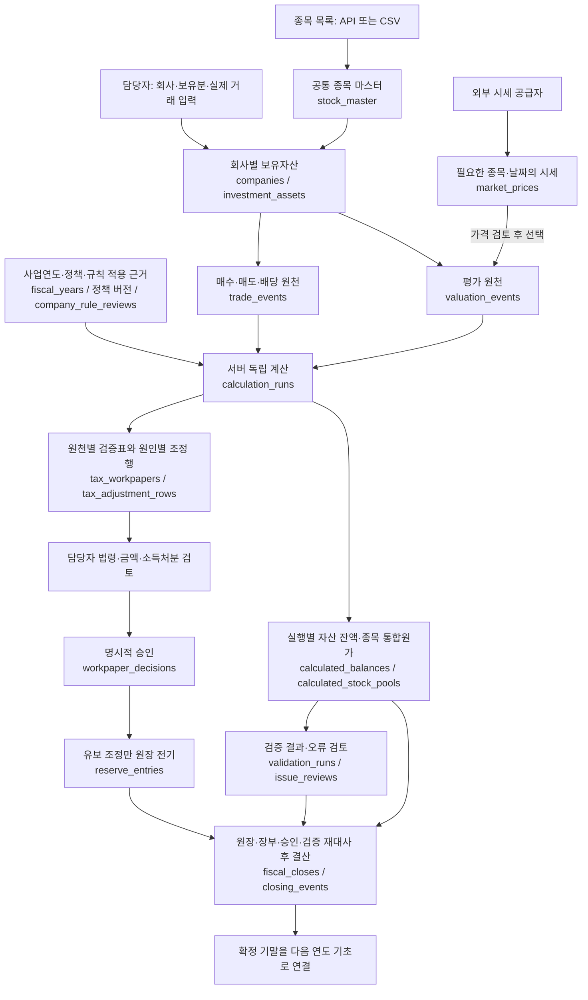
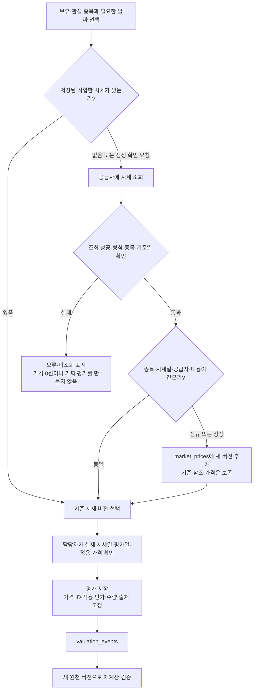
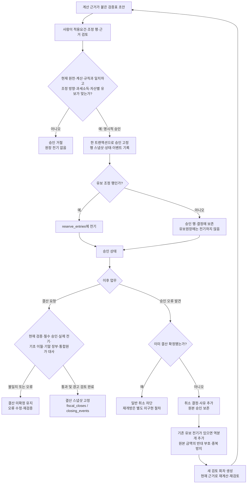
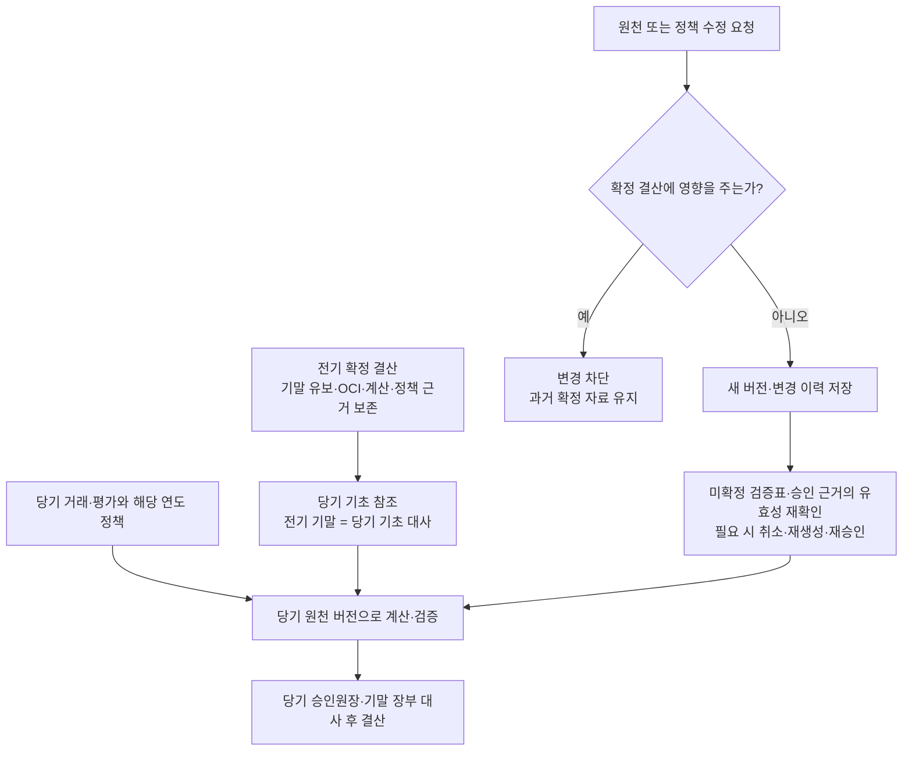
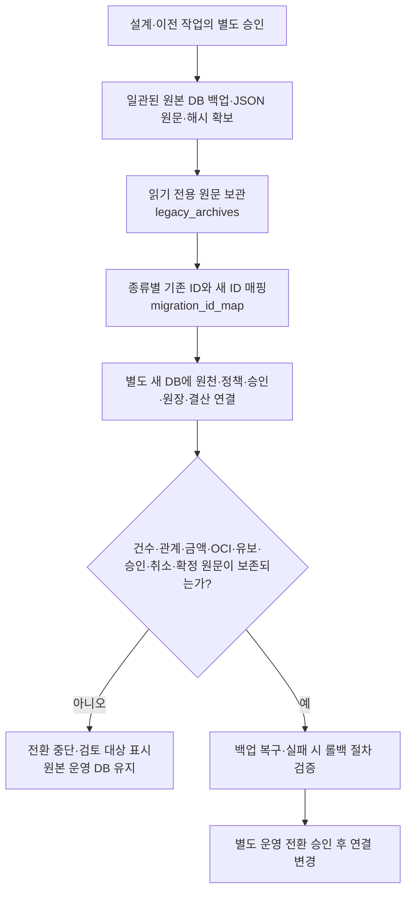

# 데이터 흐름도 — DB 보완 설계안

상태: **흐름 설계·정규화 스키마 v2·신규 DB 앱 연결 완료** · 작성일: 2026-10-26

관련 문서: [보완 ERD](DATABASE_ERD.md) · [테이블 정의서](DATABASE_TABLES.md) · [현재 업무 흐름](WORKFLOW.md)

ERD가 **무엇과 무엇이 연결되는지**를 보여 준다면, 이 문서는 **자료가 어디서 들어와 어떤 검토를 거쳐 어디에 저장되는지**를 보여 준다. 아래 저장소 이름은 별도 표시가 없으면 보완 DB의 제안 테이블명이다. 원천·정책·계산·승인·원장·결산은 신규 DB 앱에 연결했다. 외부 시세 영구 캐시와 기존 DB 이전 흐름은 향후 계획이다.

## 1. 전체 데이터 흐름

핵심 구분:

- **외부 자료:** 종목 목록·시세. 실제 회사의 체결내역이나 승인 결과가 아니다.
- **원천 자료:** 담당자가 확정한 거래·평가와 적용 정책. 수정 시 버전을 남긴다.
- **계산 결과:** 해당 원천 버전으로 계산한 잔액·손익·조정 후보. 계산만으로 원장에 전기하지 않는다.
- **승인 사실:** 검토자가 확인한 조정 행과 근거. 유보 외 행도 승인 이력에 남긴다.
- **확정 자료:** 원장과 결산 스냅샷. 최신 시세·정책으로 자동 덮어쓰지 않는다.

화살표는 주요 자료 의존성을 나타낸다. 검증 실행과 검증표 생성의 순서를 DB 관계가 강제한다는 뜻은 아니다. 검증표를 생성했더라도 결산에 필요한 현재 버전의 검증·승인·대사를 생략할 수 없다.

## 2. 종목·시세 수집과 평가 반영

이 그림의 **영구 시세 보관·재사용·정정 버전 관리는 제안 기능**이다. 현재 앱의 KRX 조회는 화면에 가격을 채워 주며, 사용자가 거래·평가를 저장해야 업무 자료에 반영된다. 현재 종목 마스터 입력은 직접 등록·CSV가 중심이며 종목 전체 API 동기화가 구현된 것으로 간주하지 않는다.

보관할 시세는 필요한 종목·날짜에 한정한다. 공급자 API가 시장 전체 응답을 반환하는 경우 네트워크 응답 범위와 영구 보관 범위는 다를 수 있다. 현재 종가와 실제 체결단가를 혼용하지 않으며, 휴장일 직전 가격을 사용할 때는 요청한 평가일과 실제 시세일을 별도로 남긴다.

## 3. 검증표 승인·취소·재승인과 결산

승인 전 검사는 **각 조정 행**에 적용되고, 결산 전에는 **실제로 전기된 원장**과도 다시 비교한다. 기말 합계만 같다고 거래별 전기 오류를 허용하지 않는다. 취소는 원본 행 삭제가 아니며, 유보가 없는 승인 취소에는 가짜 역분개를 만들지 않는다.

자동 규칙의 적용범위가 미확인이거나 예외라면 확정적인 조정 행을 임의 생성하지 않는다. 별도 법령 검토가 필요하다. 검증 경고의 검토 확인이 계산 불일치 오류를 무시하는 수단이 되지는 않는다. 세부 적용범위는 [2026 조정 규칙](TAX_ADJUSTMENT_RULES_2026.md)을 따른다.

## 4. 다음 연도 이월과 원천·정책 수정

전기의 유보는 확정 잔액에서 이월하며, 보유분 OCI와 과거 처분 후 유지분 OCI는 계산 입력·결과의 고정 근거와 함께 대사한다. 단순히 모든 잔액을 수동 복사해 새 원천 거래를 만드는 방식이 아니다. 검산을 위해 원천을 재생하더라도 전기 확정 스냅샷을 재작성하지 않는다.

연도별 FVOCI 정책은 해당 사업연도의 처분에 적용한다. 미래 대체 정책을 추가했다고 과거 처분 후 유지한 OCI를 자동 대체하지 않는다. 자세한 계산 사례는 [사업연도별 정책·이월](FVOCI_POLICY_YEARS.md)을 참고한다.

## 5. 기존 DB와 신규 DB의 저장 방식

| 자료 흐름 | 기존 DB 호환 경로 | 신규 정규화 DB 앱 경로 |
|---|---|---|
| 종목·자산·거래·평가 입력 | SQLite의 `workspace.payload` JSON 갱신·원천 버전 증가 | 각 원천 테이블과 버전·회사별 source_revision |
| 정책 저장 | 공통 설정·연도별 배열 및 audit_log | 정책 버전·회사 연도별 규칙 적용 검토 |
| 서버 계산 | 저장된 JSON 원천을 독립 재계산 | 정규화 원천을 기존 입력 형태로 조립 후 계산 실행·결과 보존 |
| 검증·검토 | validation_runs 및 검토 상태·이력 | 계산 실행과 직접 연결한 검증·이슈·검토 이력 |
| 복수 조정 행 | 검증표 JSON 내부의 후보·승인 행 | tax_adjustment_rows 및 승인 고정본 |
| 승인·취소 | 검증표·이벤트·정정 기록과 유보 전기·역분개 | 명시적인 승인/취소 결정과 조정 행·원장 FK 연결 |
| 결산·이월 | fiscal_closes·closing_events의 확정 JSON과 계산 근거 | 기존 확정 원문 보존 + 회사·연도·계산·승인의 명확한 연결 |

자료의 보관 구조를 바꾸는 작업과 계산 엔진의 금액·정책 의미를 바꾸는 작업은 분리한다. 원 단위 반올림 기준은 이번 문서 작성으로 결정하지 않는다.

## 6. 향후 DB 이전의 데이터 흐름 — 아직 실행하지 않음

현재 DB를 제자리에서 변경하거나 두 DB에 동시에 업무 자료를 쓰는 계획이 아니다. 기존 근거가 부족한 LEGACY 자료는 원문으로 보존하며, 새로운 검증 성공·승인을 만들어 채우지 않는다. 미해결 매핑이나 확정 잔액 불일치가 있으면 운영 전환하지 않는다.

[DB 생성·앱 연결](DATABASE_SETUP.md)을 구현했으며 새 파일에서 위 업무 흐름을 실행한다. 기존 DB의 자료 이전은 아직 실행하지 않았고, 기존 파일과 반올림 기준은 보존한다.
