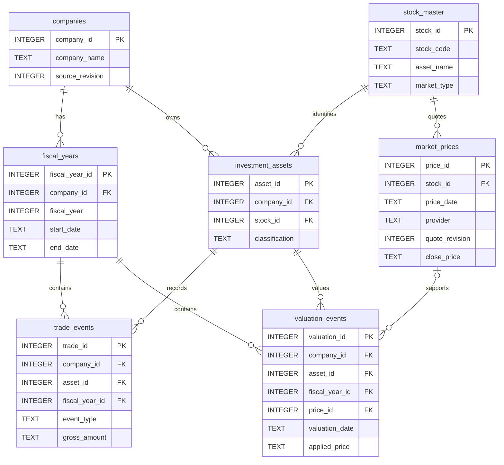
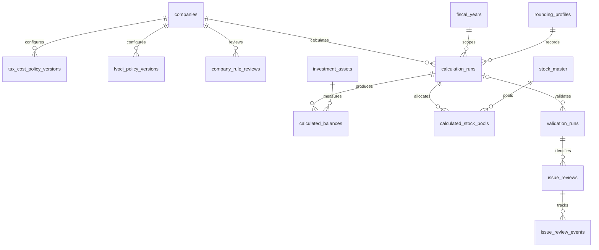
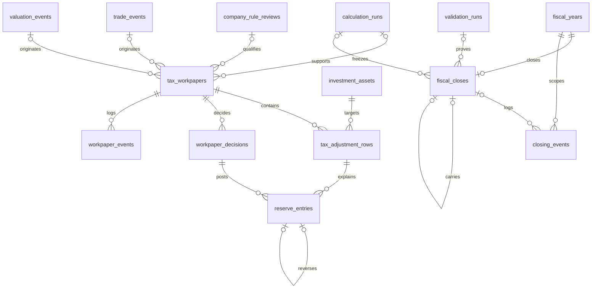

# 보완 데이터베이스 ERD — 설계안

상태: **정규화 스키마 v2·신규 DB 앱 연결 완료** · 작성일: 2026-10-26

이 문서는 [기존 투자자산 ERD](https://github.com/chie3333/python_study/tree/main/projects/tax_adjustment)를 현재 프로젝트에 맞춰 보완한 구조다. [DB 생성·앱 연결](DATABASE_SETUP.md)에서 원천 저장·서버 계산·승인·원장·결산 서비스를 구현했다. 신규 DB는 정규화 테이블을 사용하고, 기존 JSON DB는 이전 없이 원래 방식으로 보존한다. 금액 처리 단위는 변경하지 않았다.

필드·제약·이전 기준은 [테이블 정의서](DATABASE_TABLES.md), 실제 연결 범위와 남은 기능은 [구현 안내](DATABASE_SETUP.md)를 함께 본다.

자료가 들어와 검토·승인·결산으로 이어지는 순서는 [데이터 흐름도](DATABASE_DATA_FLOW.md)를 참고한다. 현재 저장 방식과 제안 저장 방식, 취소·재승인 및 향후 이전 흐름을 구분했다.

## 1. 기존 ERD에서 바꾸는 핵심

| 기존 구상 | 보완 방향 | 이유 |
|---|---|---|
| 종목과 보유자산 | 공통 `stock_master`와 회사별 `investment_assets` 분리 | 같은 종목을 회사별·회계분류별로 보유할 수 있음 |
| 거래 | `asset_id`로 보유자산에 연결 | 종목코드만으로 FVOCI·FVTPL 처분 대상을 구분할 수 없음 |
| 평가 | 보유자산에 연결하고 시세 근거를 별도 참조 | 같은 종목이라도 평가 대상 보유분·수량을 구분 |
| 현재 잔액 | 계산 실행별 `calculated_balances` 및 종목별 원가 풀 | 최신값을 덮어쓰는 구조와 확정 결산을 구분 |
| 세무조정 | 검증표 한 개에 여러 `tax_adjustment_rows` 연결 | OCI 자본 연결·평가 부인·처분 연결을 각각 보존 |
| 거래에서 조정 발생 | 거래 **또는** 평가 한 건에 검증표 연결 | 평가에서도 세무조정이 발생 |
| 연말 잔액만 관리 | 승인·역분개 원장과 결산 스냅샷 추가 | 취소·재승인·다음 연도 이월 근거를 추적 |

회사 구분은 향후 확장을 위한 경계다. 이것만으로 다중 사용자 인증·권한 분리가 구현되는 것은 아니다. 최초 이전에서는 현재 한 작업공간을 한 회사에 대응시키되 사업자번호 등을 임의로 만들어 넣지 않는다.

## 2. 원천 자료와 외부 시세

아래 ERD는 핵심 연결을 표시한다. 복합 외래키·버전 제약 등은 정의서에서 보완한다.

### API와 SQL의 역할

1. 종목 목록은 공통 마스터로 저장해 검색에 사용한다. API 또는 CSV라는 수집 방법과 보관 구조를 분리한다.
2. 일별 시세는 **필요한 종목·날짜만 영구 저장**한다. 현재 공급자 호출이 시장 전체 응답을 돌려주는 경우에도 그 전체 응답을 모두 시세 행으로 저장할 필요는 없다.
3. 같은 종목·시세일·공급자·동일 내용은 재사용한다. 정정된 가격은 새 버전으로 저장하고 기존 가격을 덮어쓰지 않는다.
4. 평가 확정 시 `price_id`와 실제 적용한 가격·수량을 함께 보존한다. 이후 시세 정정이나 종목명 갱신으로 과거 평가를 다시 쓰지 않는다.
5. **실제 체결단가와 API 종가는 다르다.** 매매 금액을 최신 종가로 자동 치환하지 않는다.

종목 마스터는 현재 메타데이터이며 거래·평가의 당시 명칭과 근거는 원천의 증빙 스냅샷에도 보관한다. 종목코드 변경·재사용·시장 이전은 자동 동일 종목 병합 사유로 삼지 않는다. 식별 이력이 필요한 경우 확인 절차를 거치며, 별도 식별자 이력 테이블 확장은 구현 전 검토 항목이다.

## 3. 정책·계산·검증

- 정책은 적용 시작 사업연도부터 다음 변경 전까지 상속한다. 기존 공통 정책은 이전 기간의 기준으로 보존한다.
- 정책의 새 버전을 만들 때 원본 내용은 남긴다. 확정 결산에 영향을 주는 변경·삭제·소급 추가는 차단한다.
- 계산 실행은 입력 자료·정책·엔진 버전·반올림 기준의 스냅샷을 고정한다. 회사의 현재 설정만 참조해서 과거 결과를 설명하지 않는다.
- 계산된 자산별 잔액과 종목별 통합 세무원가는 서로 다른 명세로 저장하고 합계가 일치하는지 검증한다.
- 오류·경고의 현재 검토 상태와 상태 변경 이력은 분리한다. 과거 검증 실행 결과는 덮어쓰지 않는다.

## 4. 검증표·승인·원장·결산

거래·평가 연결은 **둘 중 하나만 필수**다. 각 선의 선택 관계만으로는 이 조건을 나타낼 수 없으므로 `tax_workpapers`에 별도 XOR 제약을 둔다. 세무조정 행의 대상 자산은 원천 자산과 다를 수 있지만 같은 회사여야 한다. 혼합 보유 내부 배분을 법정 조정으로 자동 인정한다는 뜻은 아니다.

계산에서 검증표·검증으로 향하는 선택 관계는 이전 LEGACY 자료에서 당시 계산 실행 근거가 부족한 경우를 표현한다. 신규 업무에서는 성공한 계산 실행 연결이 필수다. 이전 자료의 빈 근거를 새 계산 성공 기록으로 만들어 채우지 않는다.

### 원장과 결산의 보존

- 초안은 수정할 수 있지만 승인 후 조정 행과 승인 근거는 고정한다.
- 취소는 원본 승인과 연결한 별도 결정 및 역분개를 추가한다. 승인·조정 행·원장을 삭제하지 않는다.
- 재승인은 새로운 검증표 검토 회차를 만든다. 기존 회차는 보존한다.
- 확정 결산은 계산 결과뿐 아니라 승인원장과 기초·증감·기말 유보를 대사한 스냅샷이다.
- 계산 결과를 다시 만들거나 미래 정책을 추가해도 이전 결산을 갱신하지 않는다.
- 결산 재개방은 현재 범위 밖이다. 향후 구현하더라도 기존 결산을 덮어쓰는 방식은 사용하지 않는다.

## 5. 변경 이력과 이전 자료

`audit_log`는 회사별 원천·정책의 변경 전후와 저장 버전을 기록한다. `legacy_archives`는 이전 DB의 원문과 백업 식별값을 보관하고, `migration_id_map`은 기존 ID와 새 ID의 대응을 남긴다. 기존 수동 조정은 `legacy_manual_adjustments`에 별도 보존하며 승인된 원장으로 임의 승격하지 않는다.

감사 로그의 추가 전용 운영은 DB 파일 자체의 변조 방지나 전자서명을 뜻하지 않는다. 인증·권한·감사 무결성은 별도 운영 설계가 필요하다.

## 6. 금액·잔액의 설계 원칙

- 금액과 단가는 정확한 십진 문자열로 저장하고 서버에서 Decimal 등으로 해석한다. 부동소수점 저장을 피한다.
- 원 단위 확정 규칙은 아직 결정하지 않는다. 기존 0.01원 결과는 변경 없이 보존하고 계산 실행에 당시 처리 기준을 기록한다.
- 조회용 표시, 계산 중 정밀도, 승인 원장 금액, 신고서 출력 단위를 구분한다.
- 잔여액은 별도 정책에 따라 보유 자산에 배분하고 원인과 합계 대사를 남긴다. 0주 자산으로 금액을 넘기지 않는다.
- 잔액의 기준 키는 회사·계산 실행·자산이다. 통합 세무원가는 같은 회사·같은 경제적 권리의 종목 단위로 별도 관리한다.

## 7. 실제 적용의 단계와 중단 조건

1. **설계 검토:** 이 ERD·정의서와 금액 처리 미결정 사항을 확인한다.
2. **복사본 준비:** 이후 구현 승인을 받으면 일관된 SQLite 백업을 만들고 해시·버전·건수를 기록한다. WAL 파일이 있을 수 있어 실행 중인 파일 하나만 단순 복사하는 방법을 기본으로 삼지 않는다.
3. **별도 새 DB로 이전:** 현재 DB를 제자리에서 바꾸지 않고, 새 구조의 별도 DB에서 이전을 검증한다. 두 DB에 동시에 업무 자료를 쓰지 않는다.
4. **전후 대사:** 원천 건수·ID 연결·수량·금액·OCI·유보·승인·역분개·확정 결산과 원문 보존을 비교한다.
5. **저장 계층 교체:** 계산 엔진 입력 형식은 우선 유지하고 새 테이블에서 기존 형태로 읽어 주는 어댑터를 둔다.
6. **전환 승인:** 대사·복구 테스트가 통과하고 사용자가 전환을 승인한 뒤에만 새 DB를 운영에 연결한다.

ID 연결 누락, 금액 차이, 과거 결산 재현 실패, 출처가 불명확한 조정 등이 하나라도 있으면 전환하지 않는다. 원본 DB와 백업은 보존하고 원인을 해결한다. 새 스키마 파일 생성은 운영 전환이 아니며, 현재 구현 범위는 [DB 생성·검사 안내](DATABASE_SETUP.md)를 기준으로 확인한다.
